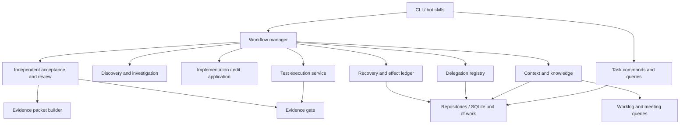

# DevelopmentFramework module map

Status: implementation design, 2026-11-15. Python 3.11+, standard library, local SQLite; no MCP or additional orchestration platform.

## Structure

Software bugfix evidence belongs to test design (`ase/testing/bugfix.py`), using
the existing hashed adequacy plan and independent Runner receipts. Task policy
selects it explicitly; verification orchestrates separate judgments. See
[bugfix evidence](bugfix-evidence.md). There is no new database or execution loop.

Organize by responsibility first. Within a responsibility, commands change state, queries return projections, services apply policy, repositories own SQL, and a unit of work owns the atomic boundary. These are roles, not mandatory base classes or one class for every noun. Existing small cohesive services remain in place; compatibility entry points remain importable.



## Modules and independently testable contracts

| Module | Owner / public entry point | Responsibility and boundary | Main checks |
| --- | --- | --- | --- |
| Task contract and authorization | `ase.tasks.TaskService` | Commands create/revise/propose/approve/transition; queries snapshot/readiness/execution_plan. Owns original obligations and scope, never runs a model. | Contract, scope, authorization, child obligations |
| Discovery and investigation | `ase.discovery`, `ase.source_coverage`, task-discovery skill | Scoped sources, colleague examples, capabilities and unresolved questions. Evidence of missing information does not establish business intent. | Discovery freshness, optional/required sources, blocker/readiness cases |
| Test design and adequacy | `ase.testing.adequacy.TestAdequacy`, domain skills | Versioned risk/scenario plans and separate current independent adequacy evidence. The bot designs tests; ase validates the configured evidence and cannot generate or prove exhaustive tests deterministically. | Missing risks/boundaries, stale/reused receipts, independent Codex scenarios, actual resulting tests |
| Workflow coordination | `ase.workflow.WorkflowController` | Owns root lock, task/stage order and transitions. Delegates checking and packet construction rather than implementing them. | Dependent stages, approved partial work, resume |
| Coordinator inbox | `ase.coordinator.CoordinatorEvents` | Original chat identity, durable deduplicated results, distinct delivery and processing attempts, conservative recovery. Bots own optional native transport; events do not grant authority. | Concurrent claims, interrupted sends, sealed result recovery, exact original chat return |
| Original-lead critiques | `ase.lead_review.LeadReview` | Full approved-intent provenance, original-main-bot additional passes, justified applicability, immutable result capture and accumulated findings. Whole-root policy never substitutes independent judgments or blocks intermediate children. | Requirements/clarifications, three-pass sequence, final currentness, capture/process recovery, independent disposition |
| Implementation | `ase.edit_application`, `ase.local_edit_intent` | Validate before-images, persist edit intent and apply/reconcile scoped changes. Does not grant new authority. | Edit inventory, atomicity, crash recovery |
| Test execution | `ase.testing.execution.CheckService` | Execute declared approved checks, collect real counts/results and bind source/plan/authority. Does not design tests or declare business acceptance. | Test parsers, mandatory checks, zero tests, changed source, credentials |
| Evidence packets | `ase.evidence.packets.PacketService`, `ase.evidence.representation`, `ase.evidence.check_inputs` | Build bounded source/current-history packets with provenance and explicit omissions. Owner-approved `review_packet` diff mode and review parts, declared private check scripts as redacted read-only context ([review packets](review-packets.md)). Does not infer success. | Required body coverage, packet bounds, source/history authority, per-file representation, exactly-one part coverage |
| Independent verification | `ase.review.service.VerificationService`, Runner + AC/review roles | Separate real sessions for acceptance and review. Advisory subagents and fixtures cannot replace local execution receipts. | Adapter contracts, receipt integrity, independent roles |
| Evidence and blocker policy | `ase.gates`, `ase.profiles`, `ase.action_evidence`, policy skills | Validate required proof, blockers and current bindings. Machine checks cover structured evidence; semantic judgments remain independent model work. | Gate regressions, scoped readiness, action proof, false negative claims |
| Knowledge and context | `ase.knowledge.Knowledge`, `ase.memory.context.ContextService` | Dated claims, explicit supersession, source refresh, conflicting alternatives, durable per-task context. Fresh source is distinct from uncontested truth. | Changed/missing dependencies, conflicts, two-task retention, CAS |
| Journal and reports | `ase.journal.Journal`, `ase.memory.repository.JournalRepository`, `ase.memory.reports.ReportService` | Journal commands append/close atomically; report queries derive effective facts and amendments from immutable history. Reports do not execute actions. | Completion, terminal next steps, late corrections, blockers, dates/DST |
| Delegation | `ase.delegations.DelegationRegistry` | Durable work DAG, exact attempts, acceptance and recovery. Bots launch native workers; ase never starts a universal pool. | Prerequisite integrity, duplicate launch, crash/result seal |
| Recovery and operations | `ase.recovery`, `ase.operations.OperationLedger` | Progress-sensitive stopping, effect intent and reconciliation. UNKNOWN never authorizes replay. | Stagnation, diagnostic leads, kill/recover, operation aliases |
| Approved effects | `ase.execution.actions.ActionService` | Approved command/access execution and operation observations. Explicit context ports retain root ownership and command authority. | Access revalidation, effect intent, credentials, completed-task observations |
| Access and delivery | credentials/access/publishing/transfer modules | Encrypted local credentials, approved origins, publication fence and portable state. No authority expansion from stored credentials. | Secrets, origin/scope, stale gate, pinned publication, export isolation |
| Storage and identity | `ase.store.Store`, `ase.state.transaction`, project modules | Connection/schema/project identity; transaction is the existing unit of work and uses savepoints inside a caller transaction. Service-specific repositories own new SQL. | Rollback, migration, nested transactions, project/workspace isolation |

## Dependency rules

- CLI and skills call services; services do not import the CLI.
- Pure report projections do not import workflow, gate, Runner or credentials. A report cannot approve or mutate a task.
- SQL for journal reading lives in its repository. Context writes participate in the session closure's existing transaction; no second connection or premature commit.
- Test execution and packet services receive an explicit workflow context. Existing controller entry points stay compatible while their bodies move into these services. No implicit attribute forwarding or new service locator.
- A current source version and a semantic agreement are separate dimensions. Conflicting unsuperseded claims require review even when all dependencies are fresh.
- Native delegation, original independent verification and local unit tests remain different kinds of evidence.
- Module test selection is discoverable and executable through `python -B -m ase.modules MODULE --test`. Cross-module integration tests and the complete suite remain required before delivery.

## Migration scope

This change extracts substantive responsibilities from the largest coordinator and journal, gives every existing subsystem an explicit test/review boundary, and fixes the five already approved memory defects. It retains current top-level APIs, SQLite schema, CLI commands, Codex/Claude/Copilot adapters and runtime trust boundary. It does not introduce a second application framework, generic repositories for every table, an event broker or a new test-generation agent loop.

The v1 execution engine (v1 `start`/`check`/`verify`/`run`/`gate`/`publish`) was retired on 2026-11-22 with the owner's approval; its protocol-only tests went with it. `core.LocalRecords` keeps time entries, decisions, session summaries and a read-only `report` for recorded v1 tasks (shown as stored, never re-evaluated; status `LEGACY_READ_ONLY`, exit code 0, because it no longer re-runs the v1 gate — a script must not use it as an approval check). A v1 contract passed to `start` is refused; an existing v1 task continues only after `task revise` to a v2 contract.

Since 2026-11-22 the framework is the owner's private tool: its own repository is the only place its files are published. `scripts/install.py` and `scripts/vendor_skills.py` install into any other Git project privately, with no opt-out: local-only instruction files, every owned path in `.git/info/exclude`, earlier managed blocks removed from team instruction files and already-tracked destinations refused. There, `task finish` writes a PR body about the change only, and the routing and orchestrator skill forbid committing framework files, adding framework CI or hooks, or naming the framework in commits and PRs. This is local tooling; nothing on the server enforces it. Ignored files are disposable to Git: `git clean -fdx`, or checking out a branch that tracks one of these paths, removes or overwrites the local installation, so reinstall afterwards. The owner's short project hints live in `.devframework/hints.md`; the installer copies them into every local routing block and excludes the file from Git (eval round 11 in `outputs/chain-eval-20261124/hints`). Projects outside Git keep the earlier layout; a committed managed block in a team file is reported as `owner_cleanup` and left for the owner to remove in a commit outside any task.

The extracted action service still consumes explicit coordinator callbacks for root ownership, authorization and reconciliation. This is a documented transitional dependency: its structural port makes the coupling reviewable, but this change does not claim that each service is independently deployable. Further reducing that port must preserve the existing lease/authority and override seams.

## Discover and test a block

`python -B -m ase.modules` lists all functional modules, their owned source files, skill pointers, test files and declared prerequisite modules. For example:

```powershell
python -B -m ase.modules memory --list-tests
python -B -m ase.modules memory --test
python -B -m ase.modules reporting --test
python -B -m ase.modules evidence --test
```

The catalogue is in `ase/modules.py`. It assigns every runtime Python file and every maintained test file explicitly; a boundary test fails when a new file has no owner. Shared integration tests can cover several responsibilities. The declared prerequisite graph documents the service roles; existing compatibility call-backs are still visible through `ase/execution/ports.py`, rather than pretending this is a complete static import graph.

Test design combines instruction-driven test creation with executable plan/adequacy validation. Test execution remains separate. The coordinator inbox belongs to the coordination module; its results do not replace independent acceptance or start a model. Nothing in the catalogue grants model access, starts a worker, records an independent verdict or bypasses the original evidence gate.

The test-design module also binds cited test cases to actual successful execution.
Its native integration evidence can be checked with
`scripts/check_native_bugfix_evidence.py`; this ordinary validator retains raw
advisory outputs and leaves semantic judgment to independent review.
