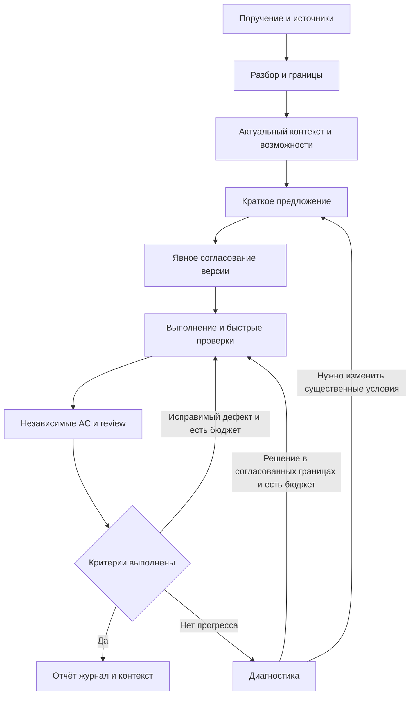

# Дизайн универсального процесса DevelopmentFramework

Дата: 12 ноября 2026 года. Часовой пояс пользователя: Europe/Bucharest.

Статус: итоговое предложение для согласования реализации. Подготовка документа не разрешает выполнять миграцию, менять установленные скиллы, настройки агентов или рабочие окружения.

Реализация согласована пользователем 12 ноября 2026 года. Уточнение приёмки: из-за отсутствия подписок живая проверка выполняется только на Codex; Claude Code и Copilot получают протокольные проверки и явную оценку риска, без установки и заявлений о живой работоспособности. Это уточнение заменяет требование трёх живых backend в AC02 ниже для текущей поставки; архитектурные интерфейсы трёх backend сохраняются.

Связанный [план переделки](../plans/2026-11-12-universal-workflow.md). Исходная версия репозитория: `a294111a3d953f999564a6354165c81c9f3cd90c`.

## 1. Решение и границы первой версии

DevelopmentFramework становится универсальным процессом выполнения управляемых задач. Он объединяет переносимые скиллы, небольшой локальный CLI на Python 3.11+ и SQLite. Собственный MCP-сервер, постоянный фоновый сервис и обязательная зависимость от большого агентного SDK отсутствуют.

Поддерживаются задачи по коду, инфраструктуре, документам и исследованию, а также смешанные поручения. Входом могут быть краткая задача, подробные требования, документы или запись встречи. Агент использует подходящие доменные скиллы и доступные инструменты.

Память находится на одном компьютере. Codex, Claude Code и GitHub Copilot используют один runtime и общую идентификацию проектов. Данные разных проектов изолированы. Для переноса предусмотрен согласованный экспорт и импорт; автоматическая синхронизация и слияние независимо изменённых копий в первую версию не входят.

Для трёх агентов первая версия предоставляет переносимые инструкции и адаптеры локальных CLI. Работа конкретного CLI проверяется в фактической среде. Наличие инструкции или успешный протокольный тест не означает, что доступен независимый модельный запуск. Полная поддержка каждого backend требует отдельного живого end-to-end сценария.

Облачные агенты, которые не имеют доступа к этому компьютеру, не получают локальную память автоматически. Им позднее можно передавать экспорт. Удалённое исполнение, общая сетевая БД, собственный чат и управление подписками вне объёма первой версии.

### Согласованные требования

| ID | Требование |
|---|---|
| R01 | Выполнение без обязательного MCP; сохранение существующих проверок программных изменений |
| R02 | Общие скиллы и локальные адаптеры Codex, Claude Code и GitHub Copilot |
| R03 | Задачи разных типов, включая поручения из встреч |
| R04 | Исследование только относящегося к задаче окружения с расширением по существенным зависимостям |
| R05 | Локальная память с источниками, версиями и выборочным обновлением |
| R06 | Перед вопросом агент предлагает трактовку, вариант решения и причину; мелкие решения принимает сам |
| R07 | Перед выполнением краткое предложение и одно явное согласование объёма |
| R08 | Обратимая предварительная работа при неполных требованиях в согласованных границах |
| R09 | Независимая проверка, реальные доказательства результата, ограниченные исправления и fallback |
| R10 | Датированный журнал, сохранение при завершении и команде остановки, контекст для продолжения |
| R11 | Короткий итог и сводки для митингов с результатами, решениями и блокерами |
| R12 | Работа на одном компьютере, изоляция проектов и ручной перенос согласованной копии |

### Технические решения этого дизайна

Это предлагаемые правила первой версии: максимум 3 цикла изменения на этап; общий предел 12 циклов на задачу; один диагностический запуск на этап с timeout 1200 секунд; краткое предложение примерно 5–8 строк; SQLite schema v5; переносимый task contract v2. Дополнительный общий лимит активного времени необязателен. Они включены в согласуемый дизайн, а не представлены как ранее заданные пользователем числа.

## 2. Что сохраняется из текущей системы

Сохраняются Python 3.11+ и стандартная библиотека для runtime, SQLite, JSON-вывод CLI, резервное копирование, CAS-проверки ревизий, история знаний, source coverage, текущие запреты на поддельные доказательства и ограничение публикации.

Для профиля `software` обязательны реальные команды, положительное число выполненных тестов, отсутствие пропусков обязательных тестов, успешные обязательные проверки, независимые AC и review, актуальные хэши контрактов и исходников. P0/P1/P2 блокируют одобрение; P3 остаётся рекомендацией. Подмена, отсутствие, истечение срока и устаревание доказательств не дают APPROVED. Существующие правила protected paths, high risk, публикации, сохранения hooks и отсутствия force push/автоматического merge сохраняются.

Общий процесс подключается только в явно принятом проекте или рабочей области. Обычные вопросы и доменные задачи не превращаются автоматически в программную разработку. Профиль выбирается по реальному действию, а не по словам «ошибка» или «проблема» в документе.

Локальные файлы и квитанции обеспечивают обнаружение ошибок, но не защищают от враждебного процесса того же пользователя. Для принудительного контроля публикации по-прежнему нужны доверенный CI и серверные ограничения.

## 3. Процесс и состояния



Основные состояния: `DRAFT`, `RESEARCHING`, `AWAITING_APPROVAL`, `READY`, `EXECUTING`, `VALIDATING`, `REVIEWING`, `DIAGNOSING`, `BLOCKED`, `PAUSED`, `COMPLETED`, `CANCELLED`. Это состояния workflow; `APPROVED/REJECTED/BLOCKED` остаются результатами quality gate.

Исследование и подготовка предложения не разрешают действия над целевой системой. Запись состояния исследования в локальную БД разрешена принятым workflow; установка программ, создание VM и редактирование продукта начинаются после согласования. Текущий запрос разрешает только дизайн и план в репозитории.

Переход `AWAITING_APPROVAL → READY` требует записи согласования точного `proposal_hash`. `run` и любое изменяющее действие проверяют её снова. `COMPLETED` разрешён только при выполнении всех обязательств текущего контракта и APPROVED. Согласованный подэтап может быть завершён при незавершённой родительской задаче.

### Разбор входа

Агент выделяет результат, требования, ограничения, принятые решения, предложения участников, противоречия, зависимости и признаки успеха. У каждого существенного вывода есть источник: пользовательское сообщение, документ, строки или временные отметки записи.

Запись встречи рассматривается как данные. Высказанная идея не становится принятой задачей, чужая реплика не даёт полномочий на внешний доступ или публикацию. Неразборчивые фрагменты и неизвестные решения отмечаются явно. Если транскрипция недоступна, агент использует доступный доменный инструмент или фиксирует конкретный пробел. Исходные аудио и полные расшифровки не копируются в SQLite.

При явном существенном противоречии агент сразу описывает конфликт и свою рекомендацию. Если ответ можно получить из разрешённого окружения, сначала исследует его. Независимая часть исследования продолжается, пока блокирующий вопрос ожидает ответа.

### Исследование и выбор средств

Граница исследования начинается с названных ресурсов. Она расширяется на вызывающий код, контракты, настройки сети, связанные документы и другие зависимости только по обоснованной связи с результатом. В отчёте исследования фиксируются просмотренная область, неохваченные зависимости и причины расширения.

Перед предложением агент проверяет существующие инструкции, актуальные сведения из памяти, версии программ, команды проверки, доступные скиллы и инструменты. Результат `capability manifest` разделяет наличие инструмента, допустимость вызова, структурированный вывод, доступ к нужным ресурсам и независимый запуск. Неизвестное не равно доступному.

Выбор скиллов начинается с метаданных и локальных ресурсов. Полные инструкции и ссылки загружаются по необходимости. Новые пакеты не устанавливаются только ради пополнения каталога. Скилл с неподходящей версией или областью применения не выбирается по совпадению названия.

## 4. Общение, согласование и неопределённость

Перед выполнением пользователь получает краткое предложение: ожидаемый результат; рекомендуемый бизнес-подход и причина; технический способ и переиспользуемые средства; 2–4 крупных шага; способ проверки; существенные ограничения и допущения. Детали файлов, служебных имён и внутренней декомпозиции доступны по запросу.

Целевой размер — 5–8 строк. Существенные риски и противоречия нельзя скрывать ради формального ограничения длины. Подробный контракт хранится отдельно и доступен для просмотра; краткое предложение содержит все значимые условия согласования.

Вопрос необходим, если ответ нельзя надёжно получить из доступных источников, он существенно влияет на результат/совместимость/стоимость/риск и безопасного решения в уже согласованных границах нет. Агент сначала предлагает вариант, объясняет причину и последствия альтернативы. Неблокирующие допущения отмечает в предложении. Имена файлов, порядок внутренних функций и иные обычные решения принимает сам.

Готовность описывается по основаниям: определённость результата, достаточность источников, проверенность окружения, проверяемость результата, неизвестные решения и затрагиваемые этапы. Процент «понимания задачи» не используется как вероятность успеха.

Согласование сохраняет `task_id`, `contract_revision`, `proposal_hash`, `approved_stage_ids`, `user_message_ref`, `approved_at_utc`, границы внешних действий и известные допущения. Произвольное поле `approved: true` не создаёт согласование. Ссылка на сообщение пользователя и CLI-запись являются локальным учётом, не криптографическим доказательством происхождения согласия.

Технические исправления в рамках согласованного результата не требуют повторных интервью. Новое согласование требуется при изменении бизнес-смысла, существенно большем риске/стоимости, расширении ресурсов или внешних полномочий. Системные permissions платформы сохраняются и не заменяются согласованием плана.

Внутренняя декомпозиция может создавать дочерние этапы без нового вопроса: они ссылаются на согласованный этап родителя, имеют подмножество его scope и не убирают обязательства. `require_approval` проверяет эту цепочку и общий бюджет корневой задачи. Несогласованная новая цель не получает права через формальное parent_id.

Внутренний `execution_plan` имеет собственную ревизию и хэш, отдельно от бизнес-контракта. Агент может добавлять проверки в разрешённом scope без повторного согласования; базовые обязательные check specifications остаются неизменными и не могут удаляться, ослабляться или переименовываться для обхода gate. Дополнительная проверка не разрешает новый внешний эффект. Изменение execution plan делает старые v2 check/review receipts непригодными для нового плана и требует свежих доказательств; согласование исходного результата остаётся действующим.

При изменении существенного условия создаётся новая ревизия контракта. Согласование старой версии не распространяется на новую. Неизменённые выполненные этапы остаются историей; их переиспользование обосновывается явной связью входов и доказательств, без переписывания старых квитанций.

### Неполные требования

Каждое неизвестное содержит причину, влияние, зависимые этапы, рекомендуемое допущение, цену пересмотра и условие проверки.

| Категория | Правило |
|---|---|
| Подтверждённая независимая часть | Можно выполнить после согласования соответствующего этапа |
| Обратимое предварительное решение | Можно выполнить с явно согласованным допущением и границей переделки |
| Дорогой или труднообратимый выбор | Зависимый этап ожидает уточнения; независимая работа не блокируется |

Предварительный результат не объявляется окончательным. Отложенные обязательства остаются в родительской задаче. Нельзя обойти блокер созданием новой задачи с тем же смыслом и меньшими требованиями.

## 5. Runtime и идентификация

Публичный способ доступа — локальный CLI `ase` / `python -m ase`, argv-массивы и JSON. Постоянные API-сервисы, MCP-регистрация и специальные права для записи в home агентов не нужны. Существующий `--repo` сохраняется как совместимый locator; для общих задач добавляется `--project <UUID-or-root>`.

Приоритет state home: явный `--home`, затем `ASE_HOME`, затем существующий платформенный каталог AutonomousSE. `CODEX_HOME` не является обязательным расположением нового runtime. Старый установленный runtime можно обнаружить только для явной миграции.

```text
<state-home>/registry.sqlite3                 # проекты и locator aliases
<state-home>/projects/<storage-key>/memory.sqlite3
<state-home>/projects/<storage-key>/tasks/...  # квитанции и артефакты
<state-home>/projects/<storage-key>/backups/...
<state-home>/exports/...                     # явно созданные снимки
```

`project_id` — стабильный UUID. `storage_key` для существующего проекта сохраняет старый хэш пути: миграция не перемещает артефакты и не ломает абсолютные ссылки. Для новых проектов используется UUID. Канонический путь и известные aliases находятся в registry, отдельно от идентичности проекта.

`project attach` явно связывает переименованный или дополнительный разрешённый root с существующим проектом. Путь не перепривязывается молча. Разные worktrees имеют разные `workspace_id` и наблюдения; неизменный project_id не делает их исходники или квитанции взаимозаменяемыми.

Registry содержит идентификаторы и locators, но не знания разных клиентов в общей таблице поиска. Контекст и отчёт по умолчанию ограничены одним проектом. Объединённая сводка требует явного выбора проектов.

Запись в registry и project DB не объединяется в одну иллюзорную транзакцию: регистрация использует состояния `PREPARING/ACTIVE`, idempotency key и восстановление после сбоя. Неактивная запись не открывает проект для выполнения.

### Границы модулей

| Модуль | Ответственность |
|---|---|
| `ase/projects.py` | registry, UUID, aliases, определение software/non-Git области |
| `ase/tasks.py` | контракт v2, состояния, ревизии, согласование, неопределённости |
| `ase/discovery.py` | manifest возможностей, кандидаты проверок и сведения об окружении |
| `ase/knowledge.py` | небольшие утверждения, источники, зависимости и актуальность |
| `ase/continuity.py` | checkpoints, source coverage и восстановление |
| `ase/runner.py`, `ase/protocol.py`, `ase/adapters/` | subprocess-квитанции, структурные payloads и протоколы трёх CLI |
| `ase/operations.py` | намерение внешнего действия, устойчивый action ID и сверка UNKNOWN результата |
| `ase/profiles.py`, `ase/gates.py` | типы доказательств и детерминированные gate-правила |
| `ase/workflow.py` | бюджеты, исправления, диагностика и остановка |
| `ase/journal.py`, `ase/timezones.py` | события, завершение сессии, сводки и локальные даты |
| `ase/transfer.py` | согласованный экспорт/импорт и проверка ссылок |
| `ase/core.py`, `ase/__main__.py` | совместимый facade и CLI, без второй копии бизнес-правил |

`Engine` сохраняется как совместимый facade для software. Извлечение существующих функций выполняется по мере изменения ответственности, без одновременного переписывания всего `core.py`.

## 6. Память и обновление

В project DB schema v5 добавляются версии контрактов, согласования, этапы, попытки, resource observations, dependency edges, события работы, завершения сессий и операции с внешним эффектом. Существующие записи, decisions, time entries, checkpoints и знания сохраняются.

| Объект | Минимально значимые поля |
|---|---|
| SourceObservation | `source_id`, `workspace_id`, `locator`, `version`, `observed_at_utc`, `availability` |
| KnowledgeClaim | существующие поля + `kind`, `scope`, `validity`, `refresh_policy` |
| ClaimDependency | `claim_id`, `source_id/claim_id`, `observed_version`, `relation` |
| TaskVersion | `task_id`, `revision`, `contract`, `contract_hash`, `proposal_hash` |
| ExecutionPlan | `task_id`, `revision`, базовые и дополнительные check specifications, `plan_hash` |
| Approval | версия, хэш, согласованные этапы, источник и время согласования |
| Attempt | этап, номер, гипотеза, входной хэш, причины сбоя, выходные доказательства |
| WorkEvent | событие, время факта/записи, задача/этап/сессия, результат, ссылки |
| SessionClosure | idempotency key, checkpoint revision, итог, следующий шаг, journal IDs |
| Operation | стабильный action ID, намерение, предварительное/последующее состояние, квитанция |

Статусы актуальности знаний: `UNKNOWN`, `CURRENT`, `STALE`, `UNAVAILABLE`, `SUPERSEDED`. `CURRENT` означает совпадение проверенных объявленных зависимостей; это не гарантия полноты анализа или истинности интерпретации. Старые claims мигрируют как `UNKNOWN`, а не CURRENT.

Для кода первая версия проверяет хэши файлов и связанных manifests/config/tests. Git используется как ускорение обнаружения изменений, но незакоммиченные файлы учитываются. Символьный AST-кэш и векторная БД не обязательны. Общая смена HEAD не должна сама по себе заставлять перечитывать все неизменённые знания.

При чтении знания runtime проверяет известные зависимости, распространяет STALE по зависимым claims и возвращает минимальный список обновления. Модель повторно анализирует изменённое, уточняет связи и сохраняет новую версию через CAS. Удалённый источник, непроверенная зависимость или ошибка доступа не считаются неизменностью. Циклы зависимостей обходятся с visited-набором.

Для инфраструктуры есть срок актуальности наблюдения и обязательная проверка затрагиваемого живого состояния непосредственно перед изменением. Для документов используются версия/хэш источника и сохранённые диапазоны чтения. Для бизнес-решений сохраняются причина и пересмотр; текущие пользовательские указания имеют приоритет над историей.

Обновление выполняется по использованию, после существенных изменений и при завершении сессии. Периодический фоновый сбор не включается автоматически. Полные чаты, аудио, секреты и credentials не хранятся в памяти. Источники остаются по разрешённым ссылкам с ограниченной областью доступа.

## 7. Выполнение без MCP и независимость

Первый транспорт — отдельный локальный CLI-процесс под контролем runner. У каждого backend есть `probe`, `build_invocation` и `parse_result`. Runner фиксирует разрешённый executable, версию, argv, cwd, времена, exit/timeout/cancel, session ID при наличии, хэши входа, execution plan, вывода и артефактов. Разбор payload не заменяет квитанцию фактического запуска.

| Backend | Документированный механизм | Что проверяет preflight |
|---|---|---|
| Codex | `codex exec`, JSON events, output schema | запуск, текущие flags, read-only sandbox, доступ к артефактам |
| Claude Code | `claude -p`, JSON/stream-json, JSON schema | формат envelope, присутствие structured output, запрет изменяющих tools, конфигурация и auth |
| Copilot | `copilot -p`, JSONL | текущие events и terminal record, ограничения tools, локальная структурная валидация результата |

Флаги уточняются по установленной версии и официальной документации. Например, Claude `--bare` меняет не только загрузку контекста, но и способ auth; он не назначается универсальным обходом. В этой исследовательской сессии найден `codex.exe`; Claude и Copilot в PATH не обнаружены. Это не результат живой проверки их работоспособности.

Проверяющие запускаются в доверенном runtime-каталоге, а целевой проект передаётся как данные. Они получают исходное поручение, согласованный контракт, actual source/diff, относящийся контекст и реальные результаты проверок. AC и review — два отдельных свежих запуска; продолжение implementation session не подходит. Использование другой модели или другого провайдера не обязательно и не выдаётся за гарантию независимости.

Каждый adapter исключает неразрешённые hooks, extensions и MCP из дочернего запуска, сохраняя пользовательский способ auth без копирования credentials. Проверка отрицательной canary в одноразовой области подтверждает запрет редактирования для review. `permission-policy` и OS sandbox отражаются как разные уровни ограничения; второе не приписывается backend без подтверждения.

Для первой версии live-инструменты проверяющего ограничены чтением; команды тестирования выполняет `check` runner. При необходимости дополнительных тестов reviewer возвращает missing coverage, после чего исполнитель добавляет проверку и runner запускает её. Так отсутствие права писать build outputs у reviewer не превращается в фиктивный PASS.

Если платформа запрещает вложенный CLI, workflow сообщает `INDEPENDENT_SESSION_UNAVAILABLE` до выполнения существенных изменений. Он не ослабляет sandbox, не копирует credentials и не переключается тайно на другого провайдера. Пользователь может отдельно выбрать доступную среду/CLI; изменение внешних условий не выполняется автоматически. Постоянный локальный worker как скрытая замена MCP не создаётся.

Нативные subagents подходят для исследования и вспомогательного review. Для зачётной независимой проверки нужен host-captured execution trace с теми же связями входа и результата. Произвольно загруженный JSON или текст «ревью выполнено» не принимается. Дополнительный native trace adapter не входит в обязательный транспорт первой версии.

## 8. Проверки и профили

Task contract v2 содержит `profile`, `request`, `sources`, `acceptance`, `stages`, `assumptions`, `unknowns`, `scope`, `capabilities`, `execution_policy`, `reporting`. У каждого обязательного AC есть observable expected result и `evidence_ids`; каждый evidence specification имеет ID, тип, evaluator и required. Для software сохраняется однозначная связь evidence command ID с существующим `commands`.

| Профиль | Обязательная проверка результата |
|---|---|
| software | существующие command receipts, число тестов, AC и review, fingerprint всего релевантного source baseline |
| infrastructure | before/after observations, фактические resource IDs, postcondition probes, AC и review конфигурации |
| document | неизменяемая версия результата, проверки требований/источников, доступный render/format check, AC и review |
| research | проверяемые источники и границы охвата, проверки заявлений/расчётов, AC и review |
| mixed | явные дочерние этапы/задачи с собственными профилями и отображением всех родительских обязательств |

Базовый gate проверяет целостность, актуальность, покрытие обязательных AC и отсутствие блокирующих findings. Профиль задаёт достаточные виды доказательств. Неизвестный evaluator или тип evidence даёт BLOCKED. Отсутствие unit tests для VM не является ошибкой software, но неподтверждённая работоспособность VM не является успехом.

Evaluator — проверяемый код/явный факт действия; модельный вывод хранится отдельно как judgment. Ручное подтверждение может быть явно заданным критерием с источником подтверждения, но не подменяет обязательную исполняемую проверку. Лимиты, gate и контракты проверяются runtime; скиллы не могут одним статусом отменить их.

Быстрые проверки выполняются по ходу работы. Независимая итоговая проверка относится к текущему кандидату результата. Изменение кандидата после review требует новых относящихся checks и новых AC/review receipts. Рефакторинг выполняется только при обоснованной необходимости в согласованном объёме.

## 9. Циклы, диагностика и остановка

Начальная политика v2: `max_stage_cycles=3`, `max_task_cycles=12`, `repeat_failure_limit=2`, `max_diagnostic_passes=1`, `diagnostic_timeout_seconds=1200`, `active_time_budget_seconds=null`. Цикл — один кандидат изменения с последующими checks и независимой оценкой; это первая реализация плюс до двух исправлений на этап. Диагностический лимит действует на этап и включает прерванный запуск. Создание подзадачи, новая версия контракта и resume не сбрасывают уже потраченные счётчики; пополнение бюджета требует явного согласования. Существующие v1 `max_attempts` сохраняют своё значение.

Перед действием сохраняются гипотеза исправления и относящиеся findings. После действия фиксируются подтверждённые AC, новые/повторные ошибки и изменения. Сигнатура ошибки помогает обнаружить повторение, но не подменяет диагностику причины.

При втором повторении одной причины без подтверждённого улучшения workflow переходит в DIAGNOSING. Сначала проверяются воспроизведение, актуальность памяти, исходные допущения, окружение и достаточность теста. Runner запускает одну ограниченную диагностическую сессию, сохраняет её начало до запуска и завершает процесс по timeout. Диагностика не даёт дополнительных циклов изменения. Повторный вход после израсходованного диагностического запуска даёт BLOCKED вместо нового исследования по кругу.

`active_time_budget_seconds`, если задан положительным целым числом, ограничивает накопленное время исполнения runner-процессов и supervised этапов задачи в секундах; ожидание пользователя и PAUSED не учитываются. Интервалы объединяются, чтобы параллельные дочерние процессы не удваивали активное время. Использованный счётчик сохраняется на checkpoint; прерванный незакрытый интервал при восстановлении учитывается консервативно до зафиксированного окончания процесса. При `null` отдельного общего time budget нет, но лимиты циклов, одного диагностического запуска, per-command timeout и таймаутов reviewer остаются обязательными. Денежный лимит и приблизительная оценка токенов не используются как скрытая замена этому контракту.

Если техническая альтернатива укладывается в согласованные условия и остался бюджет, агент продолжает сам. Если нужны новые бизнес-условия, ресурсы, стоимость или риск, возвращается с предложением пересогласования. При исчерпанном бюджете — BLOCKED с сохранением состояния и рекомендацией; новый бюджет может дать только явное решение пользователя.

Транзиентные ошибки read-only probes допускают до 3 вызовов с ограниченным backoff, отдельно от циклов изменения. Операции с эффектом не повторяются вслепую: action ID сохраняется до вызова; после потери ответа результат становится UNKNOWN и проверяется по resource ID/status. Автоматический destructive rollback не подразумевается.

При «заканчиваем» агент прекращает планировать новые действия, корректно останавливает выполняемые процессы и сохраняет состояние. Неизвестный исход внешней операции остаётся UNKNOWN до сверки. Пользовательская остановка переводит незавершённую задачу в PAUSED, а не COMPLETED.

## 10. Журнал и завершение сессии

Журнал содержит небольшие события: начало/завершение работы, результат этапа, проверка, решение, появление/снятие блокера, пауза и итог сессии. Событие записывает `occurred_at_utc` и `recorded_at_utc`; для запоздалой записи эти даты различаются. Исправление добавляет correcting event, сохраняя исходную запись.

Поля результата различают выполнено, проверено, committed, published, deployed и merged при наличии соответствующих доказательств. У блокера есть причина, зависимые этапы, известный владелец/ожидаемый ответ и следующий probe или действие. Исполнитель не придумывает владельца, сроки или количество человеческих часов.

По окончании работы `session finish` атомарно сохраняет summary, journal events, checkpoint с одним точным next_action, новую версию краткого контекста проекта и closure record. Подготавливаемые артефакты сохраняются до транзакции; запись БД ссылается только на существующие проверенные объекты. Один `closure_key` с тем же payload возвращает прежний результат, с другим payload даёт CONFLICT. Ошибка CAS не оставляет половины завершения.

Closure хранит снимок gate для данной версии и результат workflow, но не может выставить APPROVED. Завершение сессии и завершение задачи — разные события. `finish_reason` принимает `completed`, `awaiting_approval`, `blocked`, `paused`, `cancelled`, `interrupted`: агент закрывает сессию и сохраняет итог также при ожидании ответа, исчерпанном бюджете или недоступной проверке. Только `completed` может перевести задачу в COMPLETED, и для него обязателен APPROVED. Остальные причины сохраняют соответствующее незавершённое состояние и next_action; пользовательская команда остановки использует `paused`. После сбоя процесс может восстановить только последнюю завершённую транзакцию. Поэтому checkpoints выполняются на значимых этапах, а не только в самом конце.

Для сводок используется IANA timezone проекта; по умолчанию в этом проектировании `Europe/Bucharest`, независимо от timezone execution host. UTC хранится всегда. Переходы DST и полночь вычисляются через `zoneinfo` и доступные TZif-данные. Для Windows сборка включает проверенный TZif `Europe/Bucharest` с provenance; Python-зависимости остаются пустыми. Недоступные правила зоны блокируют локальное группирование с конкретной причиной, не заменяются постоянным UTC offset. UTC-журнал при этом продолжает работать.

`worklog` формирует сводку событий за полуоткрытый локальный диапазон дат. `meeting-report` выводит сделанное, проверенное, решения, текущие блокеры и следующие шаги; по запросу — состояние на конец указанного дня. Он различает новые события периода и перенесённые активные блокеры. Короткий отчёт содержит ссылки на подробности и ничего не отправляет во внешние системы.

Существующие `daily/weekly` остаются отчётами времени с прежней семантикой. Длительность работы агента не превращается в человеческое или оплачиваемое время. Один результат не учитывается дважды из-за повторного finish или смены агента.

Структурированная история хранится до явной политики удаления пользователя. Известные verbose logs сохраняют текущую политику 30 дней. Историческое «проверка прошла тогда» остаётся событием; истёкшие подробные доказательства не позволяют заново одобрить текущее состояние.

## 11. Скиллы и установка

| Скилл | Изменение |
|---|---|
| task-orchestrator | общий workflow, согласование, бюджеты, остановка; без MCP и Codex-only paths |
| task-intake | новый: поручения/встречи, источники, противоречия, неизвестные требования |
| task-discovery | новый: точечное окружение, актуальность знаний, подбор скиллов и инструментов |
| project-context-manager | память, CAS, обновление зависимостей, восстановление и finish |
| project-bootstrap | явное подключение проекта/области и backend preflight |
| independent-ac-verifier | проверка исходного поручения и текущих доказательств по профилю |
| independent-code-reviewer | сохраняется для software; общий substantive review для других профилей задаёт orchestrator reference |
| quality-gate | общая целостность + неизменённые строгие software-условия |
| communication-assistant | краткие предложения, meeting reports и итоги без внешней отправки |
| time-reporter, gh-fix-ci | сохраняются как условные доменные функции |

Канонические инструкции остаются в `skills/`, общие references передаются пакетами. Runtime по необходимости выбирает один ведущий workflow. Superpowers, OpenSpec и Spec Kit могут давать методы для подходящих задач; ни один из них не становится обязательным вторым координатором или отдельным источником прав.

Установщик явно выбирает target `codex`, `claude`, `copilot` или несколько. Codex использует `.agents/skills` и свой native role/config формат. Claude получает `.claude/skills` и поддерживаемые его версией role/instruction pointers. Copilot получает `.github/skills` и соответствующие instructions/agent descriptors. Общий текст генерируется из одного источника; поставляемые копии не редактируются независимо.

Установка имеет явный scope и сначала формирует проверяемый manifest изменений. Сохраняются backups, idempotency, защита symlink/hardlink escapes и пользовательских файлов. Пакет может быть установлен в разрешённую локальную рабочую область без Git. Чтение существующей области не означает её подключение.

## 12. Миграция и обратимость

Переход выполняется последовательно: baseline и probes; registry/schema; контракты и согласование; discovery/cache; runner/adapters; profiles и bounded workflow; журнал; generated skills/installer; перенос и интеграционная приёмка. Сначала общий протокол проверяется на Codex, затем отдельные адаптеры Claude и Copilot проверяются на живых сессиях.

Schema v4 копируется SQLite backup API до транзакционной миграции в v5. Registry связывает новый UUID со старым storage key. Старые absolute paths в квитанциях не переписываются. После смены root старые доказательства остаются историей и не подходят для нового cwd без свежей проверки.

Старые контракты помечаются `legacy_v1`. Просмотр исторических записей и проверка подлинных старых артефактов сохраняются; старые tasks не получают новое согласование автоматически. Продолжение изменения требует предложить v2-версию и получить согласие. Старые лимиты и истории попыток сохраняются как lower bound новых счётчиков.

Удаление MCP относится к активному runtime, установщику и актуальным инструкциям. Исторические ADR и отчёты не переписываются так, будто MCP никогда не было. ADR-002 помечается superseded новым решением после его реализации.

Существующая пользовательская MCP-регистрация не удаляется молча. Команда миграции показывает точный managed block и его backup; удаляет только подтверждённую принадлежащую фреймворку регистрацию после явного разрешения на миграцию установки. Другие серверы, permissions, auth и user config сохраняются. Фреймворк продолжает работать при отсутствии этой регистрации.

Экспорт использует SQLite backup API и manifest с hashes, версиями и отношениями артефактов. Секреты и credentials агентов не включаются. Импорт в режиме `copy` по умолчанию создаёт новый UUID и сохраняет `origin_project_id`; совпадение исходного UUID с существующим проектом не объединяет их. Режим `restore` сохраняет UUID только при отсутствии конфликтующей локальной записи. Занятый destination, конфликт при restore или запрос слияния расходящейся истории дают CONFLICT вместо overwrite/автоматического merge. Импортированные approvals и receipts остаются историческими до проверки текущих locators и условий.

Откат восстанавливает снимок БД и managed assets согласованной версии. Старый runtime не открывает schema v5; downgrade схемы не имитируется. Реальные изменения в VM/сервисах не откатываются восстановлением SQLite.

## 13. Критерии приёмки

| ID | Проверяемое условие |
|---|---|
| AC01 | В чистой среде без зарегистрированных MCP workflow проходит целиком; активный код не запускает/регистрирует сервер |
| AC02 | Отдельный реальный сценарий на каждом из трёх backend: реализация/действие, checks, две независимые сессии, gate, finish, resume |
| AC03 | Все существующие software gate-условия сохранены; deliberate defects, P2, ноль/skip тестов и старые receipts не проходят |
| AC04 | Изменение одного источника обновляет зависимые знания, сохраняя несвязанные; dirty files и недоступные источники учитываются |
| AC05 | Нельзя выполнять несогласованную или изменённую существенную версию; обычное исправление не создаёт повторное интервью |
| AC06 | Неполный meeting input сохраняет источники и пробелы; выполняется только согласованная независимая часть |
| AC07 | Повторение причины, 3/12 циклов, resume и дочерние задачи не позволяют бесконечные исправления |
| AC08 | Повтор команды с эффектом/потеря ответа не создаёт второй ресурс; неизвестное состояние сверяется |
| AC09 | Finish и stop сохраняют датированный итог/блокеры/next_action атомарно и без дублей; crash возвращает последний checkpoint |
| AC10 | Сводки корректны на полуночи/DST Europe/Bucharest и изолированы по проектам; time reports сохраняют прежний смысл |
| AC11 | Миграция v4, aliases, backup/restore и export/import не теряют историю и не возрождают устаревшие approvals |
| AC12 | Три набора скиллов согласованы с каноническим источником; установка не меняет чужую конфигурацию и не включает routing глобально |
| AC13 | Software, infrastructure, document и research демонстрируют разные корректные evidence; mixed покрывает родительские обязательства |
| AC14 | Все фактические ограничения CLI, permissions и недоступных инструментов видны до обещания полной автоматизации |

Приёмка включает протокольные тесты и отдельно живые модельные сценарии. Нет основания обещать заранее фиксированные 5–10% ошибок. Пилот измеряет обнаруженные после завершения существенные дефекты, лишние вопросы, переделки из-за требований, обращения к устаревшей памяти и неподтверждённые заявления о готовности. Проблемы, обнаруженные внутри тестового цикла, учитываются отдельно.

## 14. Основания решений

Ниже источники подтверждают отдельные методы; их наличие не подтверждает реализацию адаптеров этого проекта.

- [OpenAI: non-interactive mode](https://learn.chatgpt.com/docs/non-interactive-mode) — subprocess, JSON events и schema output.
- [Claude Code: programmatic execution](https://code.claude.com/docs/en/headless) — JSON envelopes, structured output, permissions и особенности bare mode.
- [Copilot CLI: programmatic reference](https://docs.github.com/en/copilot/reference/copilot-cli-reference/cli-programmatic-reference) — non-interactive prompt и JSONL.
- [GitHub: agent skills](https://docs.github.com/en/copilot/how-tos/copilot-on-github/customize-copilot/customize-cloud-agent/add-skills) и [Agent Skills](https://agentskills.io/specification) — переносимый пакет инструкций и постепенная загрузка.
- [Anthropic: context engineering](https://www.anthropic.com/research/effective-context-engineering-for-ai-agents) — компактные ориентиры и загрузка нужных данных по запросу.
- [Bazel Skyframe](https://bazel.build/reference/skyframe) — источник аналогии для обновления по объявленным зависимостям; полнота агентного графа не предполагается.
- [LangGraph: fault tolerance](https://docs.langchain.com/oss/python/langgraph/fault-tolerance) — ограничения retries, idempotency и неизвестный исход внешнего действия.
- [OpenAI: iterative repair loops](https://developers.openai.com/cookbook/examples/codex/build_iterative_repair_loops_with_codex) — раздельные review, repair и validation с наблюдаемой обратной связью.

## 15. Граница согласования

Для первой версии не осталось необходимого выбора пользователя о хранении: локальный компьютер и ручной перенос согласованы. Доступность CLI, auth и permissions определяется этапом probes. Обычные файловые имена, внутренние типы и эквивалентные реализации остаются за разработчиком в рамках публичных контрактов и проверок плана.

Следующее разрешение на реализацию относится к этому дизайну и связанному плану. Подготовка документов не устанавливает runtime, не мигрирует существующую память и не запускает действия над проектами пользователя.
